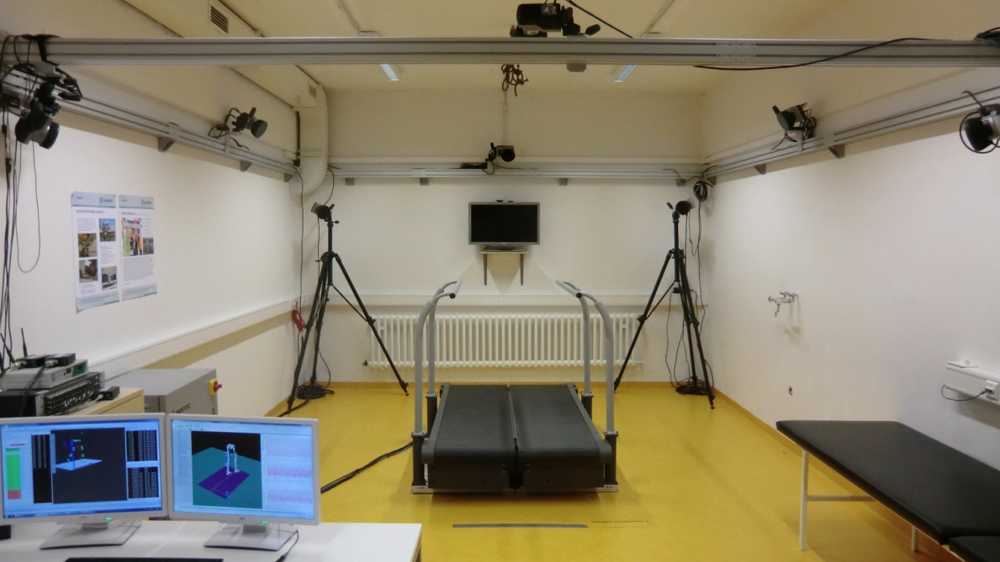
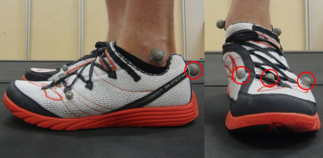
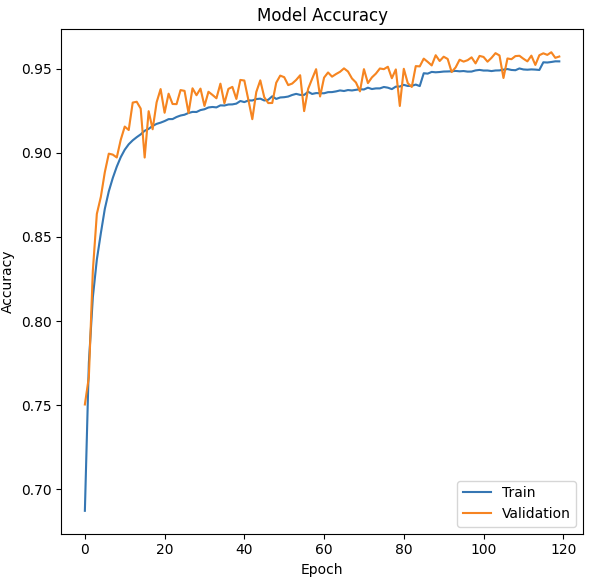
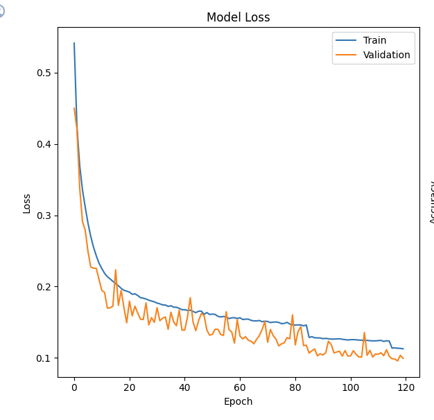
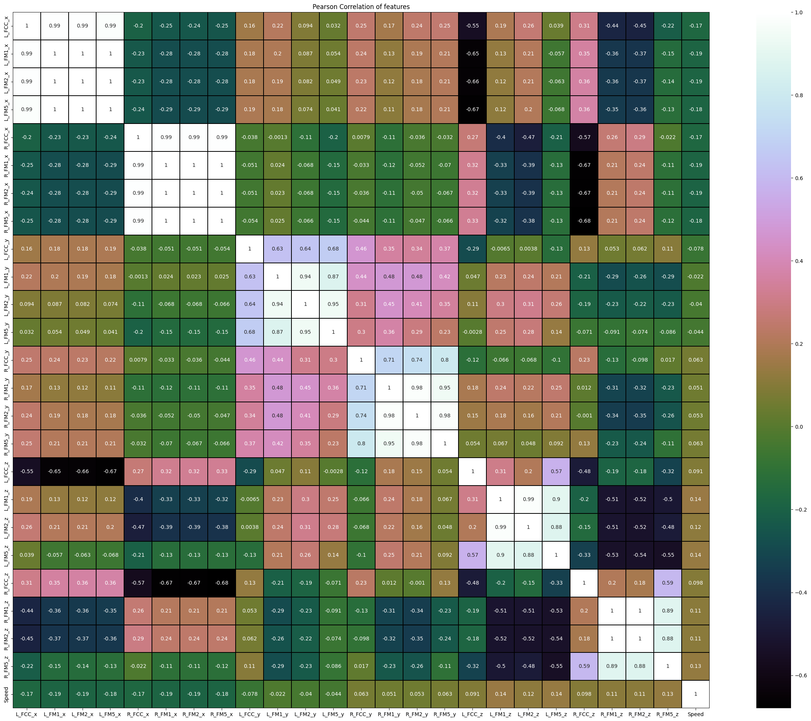

# Walking Speed Classification

A deep learning course project that classifies human walking speed from foot position marker data using a 2D Convolutional Neural Network (CNN).

- Course: ECE 491/591 Deep Learning
- Institution: University of Maine
- Term: Fall 2023 (December 2023)
- Authors: Colby Ellis and Ehsan Sharafian

## Summary

The project classifies walking speed into 12 categories based on the positions of markers placed on the feet. Four markers are placed on each foot, giving 24 position values per sample. Each sample is reshaped into a 4 by 6 grid and treated as a 2D image, so that 2D convolution can extract the spatial relationships between markers. The 12 output classes are represented with one hot encoding.

The data comes from a Kaggle human gait phase dataset. It includes 21 subjects (10 male and 11 female). Each subject walked in a laboratory at 12 different speeds from 0.6 m/s to 1.7 m/s in steps of 0.1 m/s, walking at each speed for one minute.

### Data and markers

*Motion-capture gait laboratory with an instrumented treadmill.*

*Reflective markers placed on each foot. Four markers per foot give the 24 position values used as the model input.*

## Method

The report first evaluates standard scikit-learn classifiers as a baseline, then builds a custom CNN:

- Input: 24 marker position values per sample, reshaped to a 4 by 6 grid in 2D.
- Output: 12 speed classes encoded with one hot encoding.
- Model: one convolutional layer with 32 filters, followed by max pooling, a flatten layer, a dense layer of 128 neurons with ReLU activation, a dropout layer, and a final dense layer of 12 units with softmax activation.
- Loss function: categorical crossentropy.
- Optimizer: Adam, starting learning rate 0.001, adaptive with a minimum of 1e-6.
- Batch size: 64.
- Epochs: 120.

Training and compiling took about 35 minutes.

## Results

As reported:

- Final training accuracy: 94 percent.
- Final validation accuracy: 95 percent.

Baseline scikit-learn classifiers on the larger dataset performed worse:

| Classifier | Accuracy |
| :- | :- |
| Gaussian Naive Bayes | 37 percent |
| Decision Tree | 38 percent |
| Modified SVM | 56 percent |
| K-Neighbor | 73 percent |

The report also notes that reshaping the input from 1D to 2D and applying 2D convolution raised the accuracy from 73 percent for the 1D version to 95 percent for the 2D version. The report observes that validation accuracy slightly exceeds training accuracy and discusses this as a possible sign of overfitting or limited data variation, and it suggests adding force data and analyzing data over time intervals as future work.

### Training curves

| Accuracy | Loss |
| :-: | :-: |
|  |  |

Training and validation accuracy climb to about 95 percent over the 120 training epochs.

### Feature correlation

*Pearson correlation between the marker position features and walking speed.*

## Repository contents

| Path | Description |
| :- | :- |
| report/Project Report_Walking Speed Classification.pdf | Full written report |
| slides/DeepLearningProjectPresentation.pptx | Presentation slides |
| code/ProjectTest_v3.ipynb | Notebook that loads a single marker group (GP1) from a local folder |
| code/ProjectTest_v12.ipynb | Notebook that downloads the Kaggle dataset and loads three marker groups (GP1, GP2, GP3) |
| images/ | Figures used in this README, taken from the report and slides |

### About the two notebooks

Both notebooks are Jupyter notebooks written in Google Colab. The observable difference is the data they load. `ProjectTest_v3.ipynb` reads only the GP1 marker CSV files from a local project folder. `ProjectTest_v12.ipynb` downloads the dataset from Kaggle and loads the GP1, GP2 and GP3 marker CSV files, so it uses a broader portion of the dataset. Based on the higher version number and the broader data loading, `ProjectTest_v12.ipynb` appears to be the later version.

## How to open and run

- Report: open `report/Project Report_Walking Speed Classification.pdf` in any PDF viewer.
- Slides: open `slides/DeepLearningProjectPresentation.pptx` in PowerPoint or a compatible viewer.
- Notebooks: open the files in `code/` with Jupyter or Google Colab. The notebooks expect Colab style paths under `/content`, so to run them locally you need to download the Kaggle human gait phase dataset and adjust the file paths to point to the marker CSV files on your machine. The notebooks use common Python libraries including NumPy, pandas, scikit-learn and a Keras or TensorFlow backend for the CNN.

## Note

This was a university course project completed for ECE 491/591 at the University of Maine in Fall 2023. It is shared for reference and learning. The results above are reported exactly as stated in the written report.
